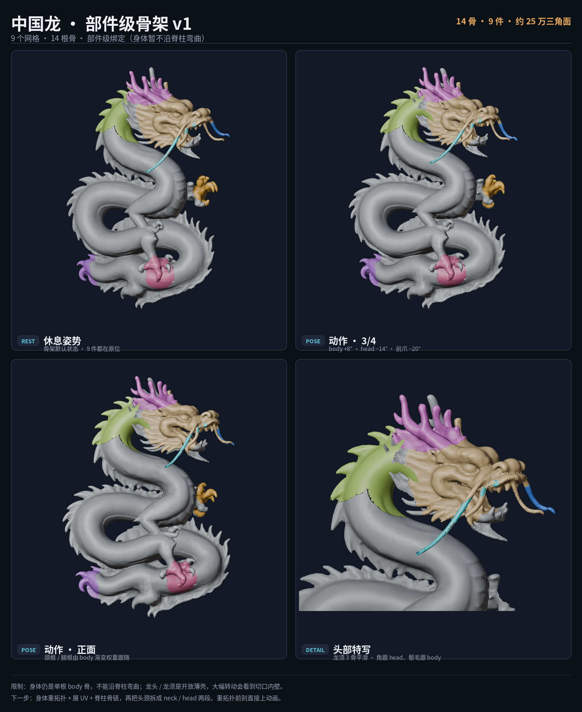

# 中国龙骨骼绑定 v1（部件级）

一句话：9 个部件已经装上 **14 根骨**，可以摆姿势、可以导出带蒙皮的 GLB。身体目前是 **一整根 `body` 骨**，不能像真龙那样沿脊柱弯曲；要弯身体，得先重拓扑，见第 7 节。



> 验收板是 Workbench 诊断渲染，颜色只用来区分部件，不是最终材质。四格分别是：休息姿势、动作 3/4、动作正面、头部特写。

---

## 0. 先看结论：这版是什么、不是什么

### 0.1 这版能做到

- **整体动**：`root` / `body` 可以带着整条龙移动、旋转、缩放。
- **头动**：`head` 转头、点头；龙角和两根龙须跟着头走。
- **鬃毛单独挂在身体上**：头转的时候鬃毛不跟着甩，仍盖在颈后。这是刻意设计的，不是漏绑。
- **三只爪独立动**：`leg_A` / `leg_B` / `leg_C` 各一根骨；转动时身体腿根会有一圈渐变，不会直接裂开。
- **龙须动**：每根龙须 3 根骨，按长度做平滑权重，可以弯出弧线。
- **导出 GLB**：1 套 skin、9 个网格、14 个 joint；在 Blender 里重新导入验证过，确实能变形。
- **接进流水线**：`rig.json` 管配置，`run_rig.py` 一条命令跑完建骨、验收、预览、验收板，并写 `verify_report.json` / `rig_report.json`。

### 0.2 这版不能做到

- **身体不能沿脊柱弯曲**。现在整条龙身是一个刚体，只能整体转；不能盘成 S 形、不能做“龙身起伏”的动画。
- **没有膝关节/肘关节**。每只爪只有一根骨，不能做屈膝、抓握。
- **没有 IK、没有动画、没有表情**。GLB 里 `animations` 是 0 条。
- **接缝仍是开放薄壳**。龙头是切开后的一层壳，大幅转头会看到颈切口的内壁；龙须 A 的根部在源模型里就有一个约 7 mm 的断口。
- **不是水密实体**。源网格有 15,740 条非流形边，打印前仍需修模。

### 0.3 为什么身体不做脊柱

不是偷懒，是这具网格现在不适合直接上脊柱：

1. 身体虽然叫“一整块”，实际由 3 个互不相连的网格岛组成，源面数约 73,121 / 9,450 / 181。
2. 整条龙有 15,740 条非流形边，是一张很薄的 AI 生成曲面，不是实体。
3. 我们试过自动提取脊柱：沿表面测地线走，路径会穿进身体内圈；改用射线量中心线，厚度在 0–70 mm 之间乱跳，找不到稳定的中心。
4. 在这种网格上硬加 6–8 根脊柱骨 + 自动权重，结果会是鳍、鳞片和薄壳被拉裂，权重还会串到旁边的线圈上。看起来“能弯”，实际上不可用。

所以 v1 先保证 **每个部件都能干净地动**，身体弯折留给重拓扑之后。这个取舍在分件阶段就说过：先分件，再重拓扑，最后才是脊柱蒙皮。

### 0.4 名词先说清

| 名词 | 大白话 |
|---|---|
| 骨架 / Armature | 一套骨头，控制模型怎么动 |
| 骨 / Bone | 骨架里的一根；有名字、有头尾、有父级 |
| 姿态模式 / Pose Mode | 不动网格，只转骨头的模式 |
| 权重 / Weight | 每个顶点“听哪根骨的话”，1 = 100% 听它 |
| 顶点组 / Vertex Group | 存权重的名单；名字通常和骨头同名 |
| 蒙皮 / Skinning | 网格跟着骨架变形的整套机制 |
| 重拓扑 / Retopo | 把乱七八糟的三角面重新排成干净的四边形面 |
| UV | 把 3D 表面摊平到 2D 的坐标，贴图要用 |
| 非流形 / Non-manifold | 拓扑不干净：开口边、重叠边、一个边挂三张面等 |

---

## 1. 交付了什么

### 1.1 文件清单

| 文件 | 大小 | 用途 |
|---|---:|---|
| `dragon01_rig.blend` | 45.6 MB | **主工程**。打开就是休息姿势；9 个部件 + `Dragon_Rig` 骨架 |
| `rig_manifest.json` | 12 KB | 骨树、每个部件的绑定方式、姿态/验收测试表；机器验收先看它 |
| `glb/dragon01_rig.glb` | 14.7 MB | 带蒙皮的 GLB：1 skin / 14 joints / 9 meshes / 0 动画 |
| `verify_report.json` | 1.8 KB | 35 的机器验收结果：容器、权重、三组变形测试，`ok: true` |
| `rig_report.json` | 5.3 KB | `run_rig.py` 的四步耗时、产物大小、验收汇总 |
| `preview/dragon01_rig_sheet.png` | 1.3 MB | 2×2 验收板，1604×1960 |
| `preview/rig_rest.png` | 1.7 MB | 休息姿势，3/4 视角，1400×1400，透明背景 |
| `preview/rig_pose_3q.png` | 1.7 MB | 动作姿势，3/4 视角 |
| `preview/rig_pose_front.png` | 1.8 MB | 动作姿势，正面 |
| `preview/rig_pose_side.png` | 1.4 MB | 动作姿势，侧面（诊断用，卷曲姿态下构图偏挤） |
| `preview/rig_pose_head.png` | 2.0 MB | 头部特写，看龙须权重和颈切口 |
| `../rig.json` | 8 KB | **流水线配置**：件名、骨名、父级、渐变半径、龙须、姿态、验收规则 |

生成脚本在 `~/ai3d/scripts/blender/`：`run_rig.py`（一键跑完四步）、`32_rig_parts.py`（搭骨架/绑定/导出）、`33_rig_pose.py`（姿势预览）、`34_rig_sheet.py`（拼验收板）、`35_verify_rig_glb.py`（重新导入验收）。配置在 `projects/dragon01/rig.json`；换模型只改这份配置，不再复制脚本。

### 1.2 骨架结构（14 根）

```text
root
└─ body
   ├─ head
   │  ├─ antlers
   │  ├─ whisker_A_1 ─ whisker_A_2 ─ whisker_A_3
   │  └─ whisker_B_1 ─ whisker_B_2 ─ whisker_B_3
   ├─ mane                 ← 注意：挂在 body 下，不在 head 下
   ├─ leg_A
   ├─ leg_B
   └─ leg_C
```

| 骨 | 父级 | 控制什么 | 绑定方式 |
|---|---|---|---|
| `root` | 无 | 整条龙的根，移动/旋转总开关 | 不直接绑网格 |
| `body` | `root` | 龙身；也带动所有子骨 | 身体 100% 跟它，切口附近分一部分给头/腿 |
| `head` | `body` | 龙头 | 龙头 100% 跟它；身体颈根用渐变跟随 |
| `antlers` | `head` | 龙角 | 100% 跟它 |
| `mane` | `body` | 鬃毛 | 100% 跟它；不跟头转 |
| `leg_A` | `body` | 右上爪 | 该爪 100%；身体腿根渐变 |
| `leg_B` | `body` | 腹前爪 | 同上 |
| `leg_C` | `body` | 左下爪 | 同上 |
| `whisker_A_1/2/3` | 链式，A1 在 head 下 | 前垂龙须，从根到梢 | 3 组平滑权重 |
| `whisker_B_1/2/3` | 链式，B1 在 head 下 | 右侧龙须，从根到梢 | 3 组平滑权重 |

骨头位置不是随手放的：头、角、三条腿的枢轴都用 **部件与身体的共享切口顶点中心**。龙须 A 用 `parts.json` 里的 9 点胶囊折线；龙须 B 用它自己表面的测地线最远路径（4.46 cm）重采样成 12 点。头的枢轴是：

```text
head  head = (0.03188, 0.02428, 0.28640)   ← 颈切口中心
      tail = (0.05768, 0.00742, 0.30299)   ← 朝头包围盒中心
```

完整坐标在 `rig_manifest.json` 的 `bones` 数组里，改骨位置请改脚本重跑，不要手改 JSON。

### 1.3 身体权重（重点）

身体有 **82,752 个顶点**，权重分两层：

- **56,552 个顶点纯 `body`**：离切口远，完全跟着身体。
- **26,200 个顶点带渐变**：在头/腿切口附近，同时吃 `body` 和对应骨的权重，按表面测地距离做余弦衰减。

切口与影响范围（Blender 工程里的数字）：

| 切口 | 共享点 | 身体受影响顶点 | 衰减半径 |
|---|---:|---:|---:|
| 头 / 颈 | 380 | 9,631 | 6.5 cm |
| leg_A 腿根 | 149 | 3,196 | 3.5 cm |
| leg_B 腿根 | 182 | 7,990 | 3.5 cm |
| leg_C 腿根 | 139 | 5,383 | 3.5 cm |

为什么用测地距离，不用直线距离：直线会把旁边一圈龙身也吸进来；沿网格边生长只影响同一张表面的邻域，线圈之间不会串。为什么头给 6.5 cm、腿只给 3.5 cm：脖子要跟着头弯一点才不裂，腿根附近网格更密，半径太大会把半条龙身带起来。

> GLB 里身体显示 114,578 个顶点，比 Blender 的 82,752 多。这是正常的：导出时按 UV 缝和法线拆顶点；权重仍然逐顶点归一化，验收脚本会检查每个顶点权重和 = 1。

### 1.4 龙须权重

- 龙须 A：886 顶点，2 个网格岛（根部小岛 123 顶点 + 主须 763 顶点），源模型自带约 7 mm 缺口。
- 龙须 B：470 顶点，1 个网格岛。
- 每根 3 根骨，权重用 **单侧 smoothstep 过渡**：关节之前 100% 跟上一根骨，关节之后才渐变到下一根。这样根部小岛不会被第二根骨拽开；代价是弯折集中在关节后的一小段，弯太大会有折痕。
- 为什么龙头特写里仍能看到根部分叉：那是源网格的缺口，不是权重裂开。见第 6 节。

### 1.5 源文件没有被覆盖

- 源模型：`~/ai3d/blend/dragon01.blend`（只读使用）。
- 分件工程：`projects/dragon01/parts/dragon01_parts.blend`（32 脚本只读打开它）。
- 绑定工程：`projects/dragon01/rig/dragon01_rig.blend`（新文件；重跑 32 会覆盖它，但不会碰前两者）。
- 所有预览都是脚本临时摆姿势渲染的，**不会把姿势写回主工程**；打开 `dragon01_rig.blend` 永远是休息姿势。

---

## 2. 三十秒验收

**做什么**：确认验收板、主工程、GLB 三样都能用，且骨架真的在动。

**怎么敲**：

```bash
cd ~/ai3d
xdg-open projects/dragon01/rig/preview/dragon01_rig_sheet.png
xdg-open projects/dragon01/rig/dragon01_rig.blend
```

打开 Blender 后：

1. 在 Outliner 里选中 `Dragon_Rig`（在 `dragon01_Parts` 集合里）。
2. 模式切到 **Pose Mode（姿态模式）**。
3. 点 `head` 骨，按 `R`，再按 `Z`，输入 `20`，回车。
4. 看：龙头转、龙角跟、两根龙须跟；**鬃毛不跟**；脖子后面身体有一小段跟着弯。这说明父子关系和颈根渐变都在。
5. 按 `A` 全选姿态骨，再按 `Alt+R` 清旋转；或者 `Pose → Clear Transform → All`。

想不看界面、整条重跑一遍：

```bash
python3 ~/ai3d/scripts/blender/run_rig.py --project dragon01
```

再跑机器验收：

```bash
~/.local/bin/blender -b --python ~/ai3d/scripts/blender/35_verify_rig_glb.py -- \
  --glb ~/ai3d/projects/dragon01/rig/glb/dragon01_rig.glb
```

**怎么算成功**：最后一行是

```text
[AI3D verify] [OK] 绑定验收通过：14.7 MB / 249,708 三角面 / 9 网格 / 14 骨 / 权重和=1
```

并且中间能看到：

- `GLB 容器：9 网格 / 1 skin / 14 joints / 0 动画 / 249,708 三角面`
- 9 个网格的权重和全部 `=1 ✓`
- `转头 25°`：头 40.4 mm、角 25.4 mm、颈根身体 23.1 mm、鬃毛 0.000 mm
- `转爪 20°`：爪 14.1 mm、腿根身体 9.4 mm、龙头 0.000 mm
- `转龙须 A 15°`：A 12.9 mm、B 0.000 mm、龙头 0.000 mm

**失败查哪**：

- 找不到 `Dragon_Rig`：确认打开的是 `rig/dragon01_rig.blend`，不是 `parts/dragon01_parts.blend`。
- 骨架被网格挡住：`Dragon_Rig` 默认开了 “In Front”；若被关掉，在 Object Data Properties → Viewport Display 里重新勾上 In Front。
- 点不到骨头：先把模式切到 Pose Mode，再点骨头的线；不要点网格。
- 转 `head` 鬃毛也动了：说明看错骨或工程是旧的；重跑 32，确认日志写 `父级 body`。
- 验收脚本报 GLB 缺文件：命令里的路径要指到 `rig/glb/dragon01_rig.glb`。

---

## 3. 在 Blender 里摆姿势（新手版）

### 3.1 先认识三件事

1. **Object Mode 是搬整个对象；Pose Mode 才是转骨头。** 选了骨架但没进 Pose Mode，转的是整个骨架对象，网格不会按关节弯。
2. **父骨带动子骨。** 转 `body`，头和腿都会跟着走；转 `head`，角、龙须跟着走，但 `mane` 不跟；转 `leg_A` 只影响那条腿和腿根渐变。
3. **骨骼的“本地轴”和世界轴不是一回事。** 新手最稳的做法是：按 `R` 后按 `Z`/`X`/`Y`，并确认顶部 Transform Orientation 是 **Global（全局）**。如果发现转的方向很怪，先 `Alt+R` 清掉，再试另一个轴。

### 3.2 做一次转头

1. 打开 `dragon01_rig.blend`。
2. 选中 `Dragon_Rig`，模式选 **Pose Mode**。
3. 点 `head` 骨（头里那根短线），按 `R`，按 `Z`，输入 `-15`，回车。
4. 想点头：再按 `R`，按 `X`，输入 `-6`，回车。
5. 想复原：`A` 全选，`Alt+R`。

**怎么算成功**：头、角、龙须一起转；鬃毛留在颈后；脖子和身体连接处有轻微跟随，不是整齐的一条硬缝。

**失败查哪**：如果整个龙都在转，你选中的是 `body` 或 `root`，不是 `head`；如果头转但龙角不转，检查 `antlers` 的父级是不是 `head`（`rig_manifest.json` 里能看到）。

### 3.3 做一次抬爪

1. 选 `leg_A`（右上爪那根，从腿根指向爪尖）。
2. `R` → `X` → `-20` 回车；再 `R` → `Z` → `6` 回车。
3. 选 `leg_B`，`R` → `X` → `14`。
4. 选 `leg_C`，`R` → `Y` → `12`。

**怎么算成功**：爪本身整体动，腿根附近的身体有一小圈跟着变形；身体远处不动。预览图里的动作就是这组参数。

**失败查哪**：如果爪动了但腿根完全不动，说明身体渐变权重丢了，重跑 32；如果整条身体都跟着抬起来，说明腿骨权重串了，跑 35 验收。

### 3.4 弯龙须

1. 选 `whisker_A_2`（A 须中间那段），`R` → `Z` → `6`。
2. 选 `whisker_A_3`，`R` → `Z` → `5`。
3. B 须同理，角度改成 `-6` / `-5`。

**怎么算成功**：龙须从关节后面开始弯，根部小岛不被拽开；另一根须不动。

**失败查哪**：如果须根和主须分开变大，先把角度降到 5° 以内；源模型本身有 7 mm 缺口，弯大了会更明显。想彻底修，见第 7 节的重建龙须。

### 3.5 看权重到底怎么分的

**做什么**：用 Weight Paint 看身体颈根的渐变是否真的存在。

1. 选 `Dragon_Body`，模式切 **Weight Paint（权重绘制）**。
2. 顶部 Vertex Group 下拉框选 `head`。
3. 红色 = 1（完全跟头），蓝色 = 0（完全不跟头）；颈根应该有一圈红色到蓝色的过渡，而不是一刀切。
4. 选 `body` 组看：大部分身体是红色，切口附近变蓝，两者互补。
5. 切回 Object Mode。不要在这个模式里乱涂；一涂就会改权重。想试就 `File → Save As` 另存。

### 3.6 保存姿势

- 想保留一个姿势：`File → Save As`，存成 `dragon01_rig_pose_A.blend`，不要覆盖 `dragon01_rig.blend`。
- 想恢复到交付状态：关掉不保存，重新打开 `dragon01_rig.blend`。
- 33 脚本渲染时不会保存，所以主工程始终是休息姿势。

---

## 4. 从头重跑绑定

### 4.0 一条命令（推荐）

**做什么**：按 `32 → 35 → 33 → 34` 跑完：建骨绑定、GLB 验收、姿势预览、验收板；最后写 `rig/rig_report.json`。前置条件只有分件工程 `parts/dragon01_parts.blend` 和配置 `rig.json`。

```bash
cd ~/ai3d
python3 scripts/blender/run_rig.py --project dragon01

# 先看会执行哪些命令，不真跑
python3 scripts/blender/run_rig.py --project dragon01 --dry-run
```

**怎么算成功**：

- 终端以 `[OK] 绑定流水线完成：4 步` 结尾，并列出主工程、GLB、清单、验收板、机器报告的路径。
- `rig/rig_report.json` 的 `"ok"` 是 `true`，`steps` 里四步都为 `"ok": true`；`verify_report.json` 的三组测试也都为 `true`。
- 本机正常约 12–20 秒（Workbench 预览很快，不含 4K 渲染）。

**失败查哪**：

- 终端写 `第「某步」步失败`：打开 `rig/rig_report.json`，看 `failed_step`、`hint` 和该步的 `returncode`；前面的步骤不会白跑。
- 只想重跑其中一段：`--build-only`（只建骨）、`--verify-only`（只验 GLB）、`--skip-pose`、`--skip-sheet`。
- 找不到 Blender / Pillow：用 `--blender` / `--python` 显式指定，或设 `AI3D_BLENDER` / `AI3D_PYTHON`。
- 配置或件名写错：先看 4.5 的键表，再用 `--dry-run` 确认路径。

### 4.1 生成骨架、绑定、GLB（分步）

**做什么**：读分件工程和 `rig.json`，搭 14 根骨，绑 9 个件，导出 GLB。

```bash
cd ~/ai3d
~/.local/bin/blender -b projects/dragon01/parts/dragon01_parts.blend \
  --python scripts/blender/32_rig_parts.py -- \
  --config projects/dragon01/rig.json \
  --out projects/dragon01/rig
```

**怎么算成功**：

- 日志出现 `骨架完成：14 根骨`、`[OK] 骨架与绑定完成`。
- 生成/覆盖 `rig/dragon01_rig.blend`（约 45.6 MB）、`rig/rig_manifest.json`（约 12 KB）、`rig/glb/dragon01_rig.glb`（约 14.7 MB）。
- 日志里的头/腿枢轴显示 `shared`；鬃毛显示 `nearest；父级 body`。
- 身体权重日志：`56552 顶点纯 body，26200 顶点带渐变`。
- 第二次重跑不会留下 `dragon01_rig.blend1`（脚本关掉了自动备份）。

**失败查哪**：

- `缺少分件`：打开的不是 `parts/dragon01_parts.blend`，或分件阶段没跑完；`rig.json` 的件名也要和分件工程一致。
- `找不到配置`：`--config` 要指到 `projects/dragon01/rig.json`，不是 `parts.json`。旧命令传 `parts.json` 也能跑，脚本会自动改用同目录的 `rig.json`。
- 头/腿枢轴显示 `nearest` 而不是 `shared`：说明切口没有重合顶点，绑定会变差；回分件阶段检查。
- 重跑会删掉旧的 `Dragon_Rig` 和旧空物体 `dragon01_Parts_Root`，这是脚本的设计；源文件不受影响。

### 4.2 渲染姿势预览

```bash
~/.local/bin/blender -b projects/dragon01/rig/dragon01_rig.blend \
  --python scripts/blender/33_rig_pose.py -- \
  --manifest projects/dragon01/rig/rig_manifest.json \
  --out projects/dragon01/rig/preview --res 1400
```

**怎么算成功**：

- 依次写出 `rig_rest.png`、`rig_pose_3q.png`、`rig_pose_front.png`、`rig_pose_side.png`、`rig_pose_head.png`。
- 最后一行 `[OK] 姿态测试渲染完成（未保存 .blend，休息姿势仍是默认）`。
- 图片是 RGBA 透明背景；在深色底上打开是正常的，不是黑图。

**失败查哪**：

- `当前没有打开 .blend`：命令里漏了 `-b projects/.../dragon01_rig.blend`。
- `姿势表里的骨头不存在`：`rig.json` 的 `preview.pose` 写错了骨名；对照 `rig_manifest.json` 的 `bones[]`。
- 背景全透明/看不清：透明是故意的；用看图软件或验收板看。需要不透明背景，把脚本里的 `film_transparent` 改成 `False`。
- 肢体断开：先在 Blender 里确认休息姿势没问题，再跑；如果休息就断，回 32 检查权重。

### 4.3 拼验收板

```bash
python3 ~/ai3d/scripts/blender/34_rig_sheet.py \
  --config ~/ai3d/projects/dragon01/rig.json \
  --manifest ~/ai3d/projects/dragon01/rig/rig_manifest.json \
  --preview ~/ai3d/projects/dragon01/rig/preview \
  --out ~/ai3d/projects/dragon01/rig/preview/dragon01_rig_sheet.png
```

**怎么算成功**：输出 `已写 .../dragon01_rig_sheet.png  (1604x1960)`；四格都有图，底部两行限制说明完整。

**失败查哪**：

- `ModuleNotFoundError: PIL`：系统的 `python3` 缺 Pillow。用 ComfyUI venv 的 Python：`~/ComfyUI/venv/bin/python scripts/blender/34_rig_sheet.py ...`。本机不需要 `apt install`，也别在 dpkg 坏掉时动系统包。
- 某一格写“缺图”：先跑 4.2，确认五张 PNG 都在 `preview/`。
- 格子被裁切：这是 `crop_content` 按 alpha 裁边的结果；头部特写本来就会裁到身体边缘，属于诊断图，不影响主工程。

### 4.4 重新导入 GLB 验收

```bash
~/.local/bin/blender -b --python ~/ai3d/scripts/blender/35_verify_rig_glb.py -- \
  --glb ~/ai3d/projects/dragon01/rig/glb/dragon01_rig.glb \
  --manifest ~/ai3d/projects/dragon01/rig/rig_manifest.json \
  --report ~/ai3d/projects/dragon01/rig/verify_report.json
```

**怎么算成功**：看到第 2 节的 `[OK] 绑定验收通过` 和三个动作测试的位移；`verify_report.json` 里 `"ok": true`，`hierarchy_ok` / `weights_ok` 都为 `true`。

**失败查哪**：

- `找不到 rig_manifest.json`：`--manifest` 指到 `rig/rig_manifest.json`；默认也会在 GLB 上面一层找。
- `GLB 网格数 ...`：导出时选错了对象；重跑 32，确认 9 个件 + 骨架都被选中。
- `找不到网格 Dragon_...`：GLB 被别的软件改过名；用原始的 `rig/glb/dragon01_rig.glb` 重试。
- `权重异常`：某个顶点权重和不是 1；回 32 重跑，不要手改 GLB。
- `鬃毛动了`：`mane` 的父级不对；重跑 32，检查日志。
- `测试规则引用了清单里没有的件`：`rig.json` 的 `verify.pose_tests` 写错了件名。
- 导入后多一个 `Icosphere`：这是 Blender glTF 导入器给骨头做显示形状用的辅助物，不在 GLB 的 9 个网格里，验收脚本会忽略它，不用管。

### 4.5 `rig.json` 怎么改（换模型看这里）

`rig.json` 是绑定阶段唯一的配置入口。脚本不再写死“龙”的件名和骨名。

| 键 | 作用 | dragon01 例子 |
|---|---|---|
| `source_blend` | 分件工程，相对项目目录 | `parts/dragon01_parts.blend` |
| `parts_config` | 分件配置，用来读龙须胶囊折线 | `parts.json` |
| `rig_name` / `file_stem` | 骨架对象名 / 输出文件名前缀 | `Dragon_Rig` / `dragon01_rig` |
| `collection` | 骨架放进哪个集合 | `dragon01_Parts` |
| `root` / `body` | 根骨和身体控制骨的名字、长度 | `root` / `body` |
| `rigid[]` | 刚性件：件名、骨名、父级、枢轴来源、尾巴方向、最小长度、渐变半径 | 头、角、鬃毛、3 只爪 |
| `whiskers[]` | 龙须：件名、骨名前缀、段数、父级、折线来源 | A 胶囊折线；B 表面最远路径 |
| `preview.pose` | 预览动作表：`[骨名, 世界轴, 角度]` | `["head", "Z", -14]` |
| `preview.head_parts` / `head_hide` | 头部特写包含/临时隐藏的件 | 头、角、鬃毛、两根须 |
| `sheet` | 验收板标题、四格文案、页脚 | 见配置 |
| `verify.pose_tests` | GLB 变形测试：转哪根骨、哪些件必须动/不能动、毫米阈值 | 转头、转爪、转须 |

几条硬规则：

1. **件名必须和分件工程里带 `ai3d_part` 标记的对象名一致**。先用 `parts/parts_manifest.json` 核对。
2. **`rigid[]` 有顺序**：父级必须写在子级前面。`root` / `body` 会先建，所以头、角、腿可以直接挂。
3. **`pivot_from` 决定关节枢轴**：取两个件切口上坐标重合的顶点中心。头取 `Dragon_Body`，角取 `Dragon_Head`，腿取 `Dragon_Body`。
4. **`blend_radius_m` 只对和身体共享切口的件有效**：头 6.5 cm、腿 3.5 cm。没有共享切口会打印 `⚠ ... 跳过渐变`。
5. **龙须 `polyline` 三选一**：`capsule`（读 `parts.json` 的胶囊点）、`surface_path`（在自身网格上找最远路径）、`points`（直接写坐标数组）。不写龙须就留空数组 `[]`。
6. **姿态和验收里的骨名必须存在**：`preview.pose`、`verify.pose_tests` 写错会在预览/验收阶段直接报错。
7. **旋转轴是世界轴 X/Y/Z**，绕骨头当前 head 转，不是骨骼本地轴；这样新手不容易被轴方向绕晕。
8. **相对路径以 `rig.json` 所在目录为基准，不是当前终端目录**。把配置复制到 `/tmp` 做试验时，`source_blend` / `parts_config` 必须写成绝对路径，否则会找不到分件配置，龙须会悄悄退回“包围盒对角线”，姿势数值也跟着变。

改完先跑 `python3 scripts/blender/run_rig.py --project <名字> --dry-run` 看路径，再正式跑。

**配置可移植性验证**：把 `rig.json` 复制到 `/tmp`，只改 `rig_name=Test_Rig`、`file_stem=test_rig`，其余路径保持绝对路径，重建后的 9 件权重、14 根骨坐标和三组姿势位移与正式工程逐项一致（转头 40.421 mm / 转爪 14.110 mm / 转须 12.929 mm）。这证明建骨和绑定链路确实由配置驱动；但它仍是同一份龙网格，不等于已经用新模型跑通。

---

## 5. 每个部件的绑定方式

| 部件 | 顶点数（Blender） | 顶点组 | 说明 |
|---|---:|---|---|
| `Dragon_Body` | 82,752 | `body` + `head` + `leg_A/B/C` | 主体刚性；切口余弦渐变 |
| `Dragon_Head` | 15,554 | `head` | 刚性；枢轴在颈切口中心 |
| `Dragon_Antlers` | 4,790 | `antlers` | 刚性；父级 head |
| `Dragon_Mane` | 8,129 | `mane` | 刚性；父级 **body**，不跟头 |
| `Dragon_Whisker_A` | 886 | `whisker_A_1/2/3` | 2 个源网格岛；3 骨平滑 |
| `Dragon_Whisker_B` | 470 | `whisker_B_1/2/3` | 1 个岛；3 骨平滑 |
| `Dragon_Leg_A` | 2,996 | `leg_A` | 刚性 |
| `Dragon_Leg_B` | 1,996 | `leg_B` | 刚性 |
| `Dragon_Leg_C` | 3,216 | `leg_C` | 刚性 |

合计 249,708 个三角面（GLB 实测）。所有件都保留独立对象；引擎里就是 9 个 skinned mesh，共用一个骨架。

---

## 6. 已知限制（请先看，再决定下一步）

### 6.1 身体不能弯

这是 v1 最大的限制。`body` 是一根骨，权重只处理头/腿切口，不处理脊柱。想让它盘起来，必须先重拓扑并加脊柱骨链；在现在的薄壳上加，会拉裂。

### 6.2 转头会看到颈切口内壁

龙头是从身体上切下来的开放薄壳。颈切口有约 380 个共享顶点和身体对齐，所以小角度转头时接缝能对上；但壳没有厚度，头转多了，从侧面就会看到壳的内壁（验收板头部特写里能看到一点）。

- 预览姿势把转头控制在 14° 左右，就是为了别把切口甩到镜头前。
- GLB 验收里故意转 25°，是测权重，不是推荐出图角度。
- 彻底修：给颈部做一圈“领口”补面，或重拓扑时把脖子做成连续管状；见第 7 节。

### 6.3 龙须 A 根部有 7 mm 缺口

源网格里龙须 A 是 2 个岛：根部小岛 123 顶点、主须 763 顶点，中间本来就有约 7 mm 空隙。分件阶段就记录过，不是绑定拉开的。

- v1 用单侧权重把根部和主须都锁在第一根骨上，尽量让它们一起动；所以静态缺口还在，但不会因为弯须而越拉越大。
- 想修：在编辑模式把两个岛的接口焊起来，或重建一根管状龙须；焊完要重新算权重。

### 6.4 鬃毛不跟头

`mane` 父级是 `body`，刻意不跟 `head`。好处是转头时鬃毛还盖着颈后，不会整片甩开；代价是头转太大时，头会从鬃毛里穿出来。等有了 `neck` 骨，可以再把鬃毛挂到 `neck` 上，并加 2–3 根次级骨做飘动。

### 6.5 腿只有一根骨

`leg_A/B/C` 都是单骨，不能屈膝、不能做脚掌滚动，也没有 IK。现在只能做“整条腿摆动”的姿势。要做走路/落地，需要每腿 3–4 根骨（大腿/小腿/脚/趾）+ IK。

### 6.6 开放边与非流形

源网格 15,740 条非流形边，切口是开放边。GLB 能正常显示和蒙皮，但不适合直接 3D 打印；打印前要补洞、加厚、修非流形。

### 6.7 GLB 没有动画

导出参数是 `export_animations=False`，所以 GLB 里只有 skin 和 rest pose，没有关键帧。想验证动画，需要另做动画并用 `export_animations=True` 重新导出。

### 6.8 顶点数看起来“变多”

GLB 里 9 个网格合计约 17 万顶点，比 Blender 工程里的原始顶点多，因为导出按 UV 缝/法线拆点。权重已经归一化，不会因为拆点变重；验收脚本每个顶点都查过。

---

## 7. 下一步：从“能摆姿势”到“能动画”

按性价比排序。前三步做完，才算真正可动画的龙。

### 第 1 步：身体重拓扑 + 展 UV + 脊柱骨链（最关键）

**目标**：让身体能沿脊柱弯曲，而不是整块转。

1. 把 `Dragon_Body` 复制一份做重拓扑（保留原文件回退）。
2. 用 Quad Remesher / Blender Quadriflow / 手动重拓扑，把身体做成沿管状走向的干净四边形；目标 3–6 万面，先别追高模。
3. 处理背鳍、腹鳍：能合并就合并；不能合并就单独留件，别让它们跟身体抢权重。
4. 重新展 UV；原来的投影贴图要重新烘，不能直接沿用。
5. 加 6–8 根脊柱骨：`spine_01 ... spine_06`，父级链，`body` 作为根；权重沿脊柱平滑过渡，不要用现在这种“切口余弦”。
6. 用同样的 35 脚本思路验收：转每根脊柱骨，身体应连续弯，不能出现折角或鳍撕裂。

**工作量**：自动重拓扑 + 清理 + UV，约 1–2 天；手动重拓扑更久。没有这一步，后面的身体动画都是假的。

### 第 2 步：颈部分段 + 封口

1. 在 `body` 和 `head` 之间加 `neck` 骨：`body → neck → head`。
2. 把现在身体颈根的渐变改成 `body/neck/head` 三段；头转时由 neck 分担一部分。
3. 给龙头颈切口补一圈面（cap），或在重拓扑时把脖子做成连续管；这样大幅转头不会看到内壁。
4. 鬃毛可以改挂到 `neck`，再加 2 根次级骨。

**工作量**：半天到 1 天（补面 + 权重 + 测试）。

### 第 3 步：腿骨链 + IK

1. 每腿拆成大腿 / 小腿 / 脚掌 / 脚趾（3–4 根骨）。
2. 加 IK 目标，方便摆落地姿势；给脚掌加限制，避免穿地。
3. 爪尖可以单独加骨，也可以保持刚性。
4. 身体腿根的渐变要跟着新的腿骨链重新算。

**工作量**：1 天左右。

### 第 4 步：龙须重建与次级动画

1. 把龙须 A 的两个岛焊成一根，或重建管状须；B 保持。
2. 每根须 4–5 根骨，权重沿弧长平滑。
3. 加 Spring/Jiggle 或手动次级动画，让须在移动时有滞后感。

**工作量**：半天。

### 第 5 步：动画与引擎验证

1. 做 idle / 飞行 / 攻击三个动作；用 NLA 或 Action 管理。
2. 导出 GLB 时打开 `export_animations=True`，确认动画名、帧率、循环。
3. 在 three.js / 引擎里重新导入，检查蒙皮、材质、动画都能播。
4. 不要直接在现在的身体上做大幅脊柱动画；先完成第 1 步。

**工作量**：动作设计另算，导出与引擎联调约半天。

---

## 8. 可重复性与排查

### 8.1 脚本顺序

```text
projects/dragon01/rig.json          ← 配置：件/骨/权重/姿态/验收
projects/dragon01/parts/dragon01_parts.blend
        │
        └─ run_rig.py（一键；也可按下面分步跑）
             ├─ 32_rig_parts.py   → rig/dragon01_rig.blend + rig_manifest.json + glb/dragon01_rig.glb
             ├─ 35_verify_rig_glb.py → 重新导入 GLB，读 manifest 的测试表，写 verify_report.json
             ├─ 33_rig_pose.py    → preview/rig_*.png（不保存姿势）
             ├─ 34_rig_sheet.py   → preview/dragon01_rig_sheet.png（系统 Python + Pillow）
             └─ 汇总              → rig_report.json
```

`run_rig.py` 会自己找 `~/.local/bin/blender` 和带 Pillow 的 Python；找不到就用 `--blender` / `--python` 指定。

### 8.2 `rig_manifest.json` 里有什么

- `schema` / `config` / `rig_name` / `file_stem`：清单格式版本、来源配置、骨架名、输出文件名。
- `rig_type: "part_level_v1"`：标记这是部件级第一版，不是最终脊柱蒙皮。
- `bones[]`：14 根骨的名字、父级、head/tail 坐标、是否 connected、是否 deform。
- `parts{}`：每个件的绑定方式；头的 `pivot` 和 `shared_vertices`，龙须的 `polyline`。
- `body_blend[]`：身体和头/腿的渐变统计（切口点数、受影响顶点、半径）。
- `preview{}`：姿态表、头部特写件、相机方向；33 直接读它。
- `verify.pose_tests[]`：35 的变形测试表（转哪根骨、哪些件必须动/不能动、毫米阈值）。
- `counts`：骨数、件数、三角面数；34 的右上角标签用它。
- `notes[]`：四条设计说明（身体刚性、非流形、鬃毛父级等），来自 `rig.json`。

### 8.3 常见问题速查

| 现象 | 最可能的原因 | 怎么办 |
|---|---|---|
| 一键命令说找不到 `rig.json` | 配置不在项目根目录，或 `--project` 写错 | 确认 `projects/<名字>/rig.json`；或用 `AI3D_RIG_CONFIG` 指定 |
| 一键命令某一步失败 | 配置/件名/骨名不对，或 Blender 异常 | 看 `rig/rig_report.json` 的 `failed_step` 和 `hint`；用 `--build-only` / `--verify-only` 缩小范围 |
| 改了件名后报“缺少分件” | `rig.json` 和分件工程的对象名不一致 | 对照 `parts/parts_manifest.json`，件名要带 `ai3d_part` 标记 |
| 改了骨名后预览/验收报错 | `preview.pose` 或 `verify.pose_tests` 还写着旧骨名 | 对照 `rig_manifest.json` 的 `bones[]` 改全 |
| 打开 .blend 看不到骨架 | 集合/对象被隐藏，或骨架在网格里 | 选中 `Dragon_Rig`，`Alt+H`；开 In Front |
| 转骨网格不动 | 在 Object Mode 转了整个对象 | 切 Pose Mode，选具体骨 |
| 头转鬃毛也动 | 看的是旧工程，或选错骨 | 重跑 32，确认 `mane` 父级 body |
| 头转颈后裂开/露内壁 | 开放薄壳 + 角度太大 | 降到 15° 内；要彻底修见 7.2 |
| 龙须根部有断口 | 源网格 2 个岛，约 7 mm 缺口 | 不是绑定问题；焊岛或重建，见 7.4 |
| 身体不能弯 | v1 就是单根 body 骨 | 重拓扑 + 脊柱链，见 7.1 |
| GLB 里没有动画 | 导出关了动画 | 这是 v1 的设计；做动画后开 `export_animations=True` |
| 权重全是 1 但形状不对 | 顶点组和骨名不匹配/修改器指错 | 跑 35；检查 Armature 修改器的 Object |
| 验收板拼不出来 | 系统 Python 没 Pillow | 用 `~/ComfyUI/venv/bin/python` 跑 34 |
| 导入引擎多出 `Icosphere` | Blender glTF 导入器的骨骼显示辅助物 | 忽略；它不在 GLB 的 9 个网格里 |

### 8.4 已知数字（排错对照）

- 骨：14
- 网格：9
- 三角面：249,708
- GLB：14.7 MB；1 skin；14 joints；0 animations
- Blender 身体顶点：82,752（56,552 纯 body + 26,200 渐变）
- 头切口：380 共享点，9,631 身体顶点受影响，半径 6.5 cm
- 腿切口：A 149/3,196、B 182/7,990、C 139/5,383，半径 3.5 cm
- 龙须：A 886 顶点 / 2 岛；B 470 顶点 / 1 岛；各 3 骨
- 验收位移（GLB 重导入）：头 40.4 mm、角 25.4 mm、颈根身体 23.1 mm、鬃毛 0；爪 14.1 mm、腿根身体 9.4 mm；须 A 12.9 mm、须 B 0
- 一键流水线：4 步；本机约 11.7 秒（建骨 3.3 s、验收 2 s 左右、预览 4.4 s、验收板 1 s）；不含 4K 渲染
- 报告：`rig_manifest.json` 约 12 KB；`verify_report.json` 约 1.8 KB；`rig_report.json` 约 5.3 KB

---

## 9. 一句话总结

这版把“9 个件能各自动、能带蒙皮导出、能验收”这件事做完了；而且已经做成配置驱动的流水线：`rig.json` 描述结构和测试，`run_rig.py` 一条命令跑完并留下两份 JSON 报告。它仍然故意没有假装身体能弯。下一步最值得投入的是 **身体重拓扑 + UV + 脊柱骨链**，做完那一步，这条龙才真正进入可动画状态。
